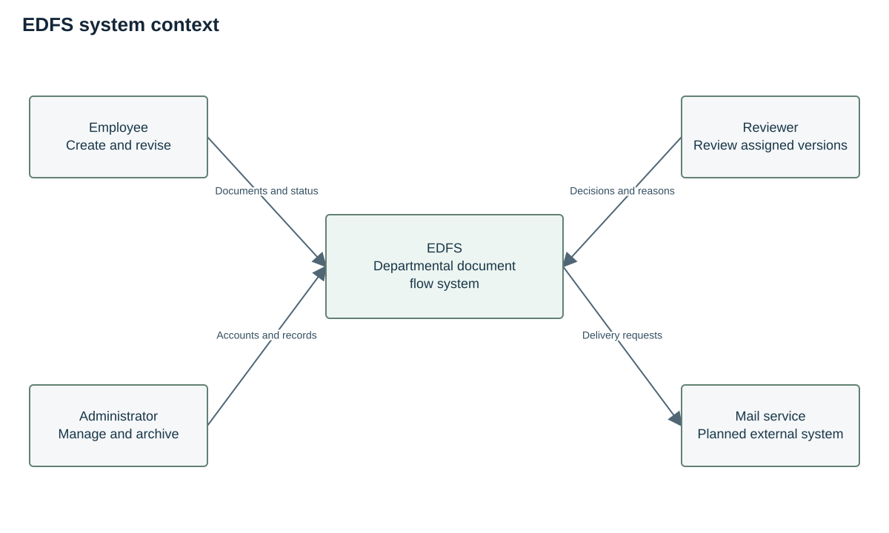
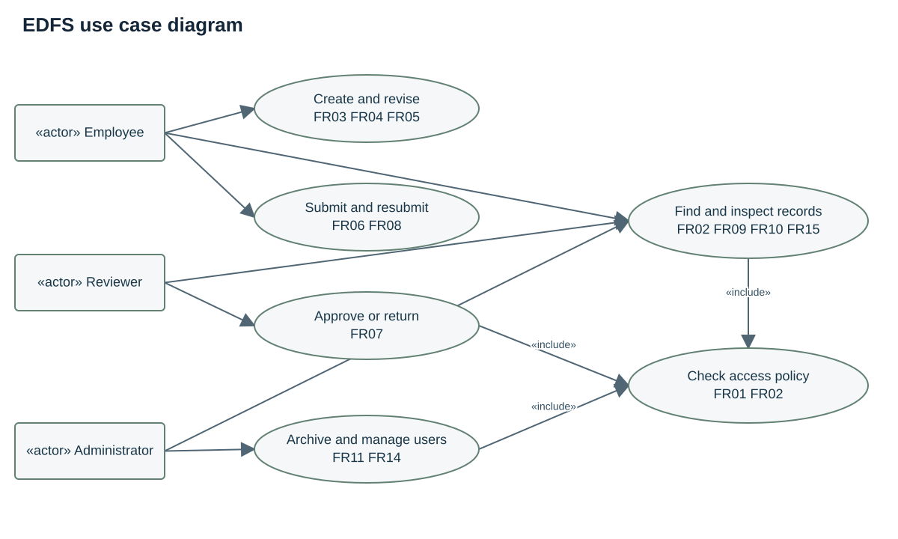
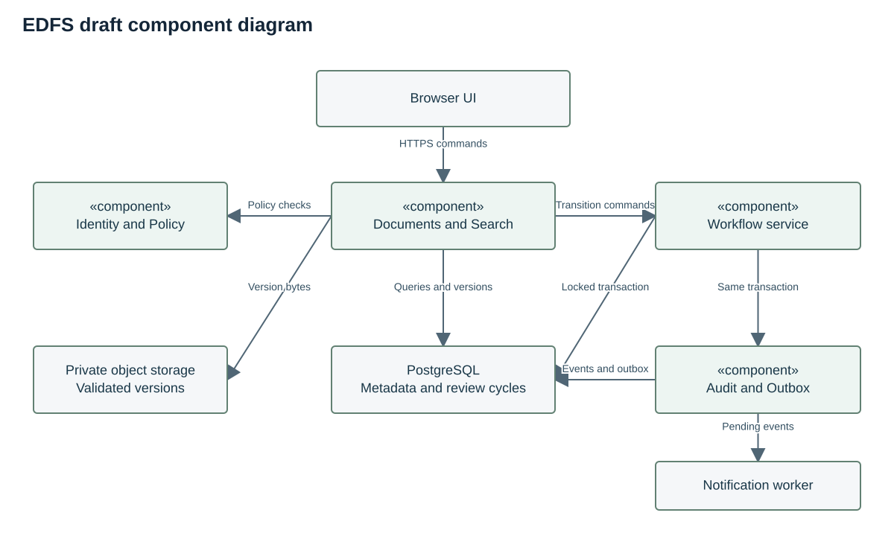

# Architecture and diagrams

## Architectural overview
The target system is a modular monolith. Browser pages communicate over HTTPS with Django views using JSON commands and multipart file uploads. Identity and policy checks precede each protected operation. Documents, workflow, audit and notifications use explicit service boundaries inside one deployment. PostgreSQL stores metadata, text bodies and workflow state. Private object storage holds validated PDF/DOCX version bytes. This proposed architecture is separate from the delivered browser-only prototype.

The three diagrams required for the first pre-defense are provided in `diagrams/`: system context, UML use case and draft UML component. Each has an editable `.drawio` source and readable SVG and PNG exports. They correspond to the same roles and components as the requirements. They describe the proposed target and the scope of the single-reviewer browser prototype, not a deployed backend. The document lifecycle, data model and transaction flow are specified in prose and in `config/schema.sql`.

## System context diagram

[Editable source](../diagrams/context.drawio) · [PNG export](../diagrams/context.png)

Employees submit drafts and revisions and receive status and history. Reviewers receive an assigned version and return a decision or a reason for requested changes. Administrators manage users and archive approved records. A planned mail service receives notification requests; a delivery failure cannot invalidate a completed decision. Committee and supervisor access the project repository and documentation rather than becoming production workflow roles.

## Use case diagram

[Editable source](../diagrams/use_cases.drawio) · [PNG export](../diagrams/use_cases.png)

The use cases include access-policy checking as a shared condition. Solid, undirected lines associate external actors with use cases; dashed `«include»` dependencies point to the access check. Reviewing requires a frozen version and reviewer assignment. Download and history inspection reuse the same visibility policy as document reading. FR identifiers in the diagram link it to the requirements table. The drawing highlights the main journeys; the permission matrix remains the complete statement of allowed actions.

## Draft component diagram

[Editable source](../diagrams/components.drawio) · [PNG export](../diagrams/components.png)

Identity implements FR01 and FR14. Policy implements FR02 and NFR01. Documents and storage implement FR03–FR05 and FR15. Workflow implements FR06–FR08, FR11 and FR12. Search, audit and notification components implement FR09, FR10 and FR13 respectively. The component diagram is a draft for the later server implementation.

## Data and consistency model
User has a role and active flag. Document stores owner, current display title, type, status, current version ID and revision counter. DocumentVersion stores a unique document and version number, an immutable title and exactly one content form: a text body, or a validated PDF/DOCX object key with hash, content type and byte size. Both forms record creator and creation time. ReviewCycle references exactly one version and reviewer. AuditEvent stores event ID, actor, document, version, action, timestamp and safe context. NotificationOutbox stores an event key, recipient, status, attempt count and next retry time.

The schema draft in config/schema.sql expresses core keys and constraints. Cross-table rules require service validation in a transaction. It is a design artifact, not an executed database migration. A decision transaction locks the document and pending review, verifies identity and the revision token, changes state, inserts the audit event and enqueues notification. A unique decision per review and an optimistic revision check prevent duplicate or stale decisions. Test this on PostgreSQL; browser state cannot demonstrate multi-user atomicity [S19].

## Storage and security boundaries
Text versions are subject to server validation, HTML escaping on display and the same version and access rules as file versions. The server accepts only allowed PDF or DOCX binaries within the configured size limit, checks content independently of the browser header and scans in quarantine [S25]. Only after validation does it publish a binary version reference. Downloads require an authenticated policy check and attachment disposition. Database backup and object backup must use a consistent manifest. Unreferenced staged objects are cleaned after a safe interval. Audit access avoids storing file bytes or authentication secrets.

## Proposed API examples
POST /documents creates a text draft and returns 201 with document ID and revision. POST /documents/{id}/versions creates an immutable text or validated binary version, with a version title in both cases. POST /documents/{id}/submit accepts reviewer ID and an If-Match revision token. POST /reviews/{id}/decision accepts approve or return, a required reason for return, and an If-Match revision token. GET /documents?q=...&status=... applies policy before returning results. GET /documents/{id}/events exports authorised history. Invalid input returns 400, absent authentication 401, denied access 403 or a non-disclosing 404, and stale commands 409. These endpoints are proposed and are not hosted backend routes in this delivery.
